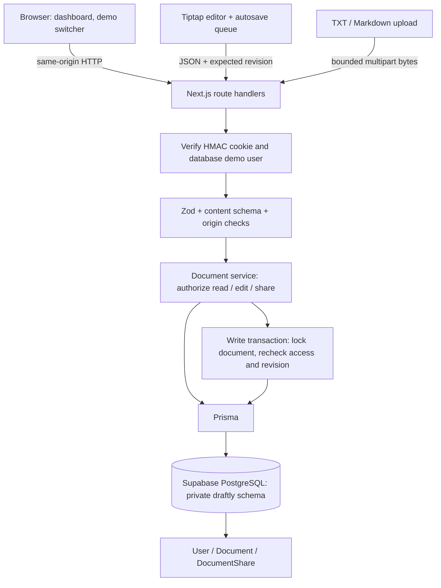

# Architecture

Draftly is one Next.js App Router application with a small, explicit server-side authorization boundary. PostgreSQL is the source of truth. Browser state is a working draft, never a source of identity or permissions.

## Data and boundaries

`User` holds demo account metadata; `Document` owns JSON content, timestamps, an owner relation and integer `revision`; `DocumentShare` joins documents to users with Editor or Viewer permission and a unique `(documentId, userId)` constraint. Owner access is implicit and cannot be downgraded through a share row. Indexes support ownership/update ordering and shared-user lookup. Foreign keys cascade owned documents and shares appropriately.

The dashboard's access predicate is applied in SQL before selecting results, including search and view scopes. Unshared document IDs return the same 404 as nonexistent IDs. Public endpoints are limited to the intentionally public demo directory/session-selection flow. Every content read and mutation resolves the signed session against the database. User IDs in sharing input identify recipients; they never identify the caller. Creation rejects client ownership fields.

The backend role owns its private schema. Table RLS is enabled without public policies to deny accidental anonymous Data API access. Prisma's table-owning role bypasses those policies, so the service's authorization checks remain mandatory. RLS is defense in depth, not a substitute for these checks. Database credentials and the signing key never enter client bundles.

## Saves and race safety

The client tracks a monotonically increasing local edit sequence, the last saved sequence and database revision. A 700 ms debounce calls a single-flight queue. Each request captures a draft and local sequence; responses advance only the captured sequence. If a newer draft exists, the UI continues to show Saving and another request uses the returned revision. A failure stops automatic retries; the UI keeps the draft and offers recovery.

Every document write or sharing change obtains `SELECT ... FOR UPDATE` on the same document row in a transaction. Authorization and revision are read after the lock is acquired. A permission revocation therefore serializes with an edit. An editor that lost access cannot pass a stale pre-lock permission check. Two writes with the same revision yield one success and one 409. Access changes themselves do not alter content revisions.

The implementation uses PostgreSQL's normal transaction isolation plus an explicit row lock rather than relying on a read-then-write check outside a transaction. Parameterized Prisma raw SQL is used only for that lock. A failed transaction rolls back; malformed bodies are bounded before decoding/parsing.

Back-to-workspace flushes the queue, unloading warns, and back navigation requires confirmation while dirty. Conflict handling deliberately does not overwrite the newer server document: download the local JSON draft, load latest, and manually reconcile. This is an honest limitation of revision-based collaboration.

## Rich text and import

The stored representation is structured Tiptap JSON, not HTML. An allowlist and Tiptap/ProseMirror schema validate node types, nesting, marks and attributes. HTML, executable URLs, image nodes and arbitrary event attributes are not accepted. The editor renders through its schema; no user `dangerouslySetInnerHTML` is used. Plain TXT containing HTML is rendered as literal text.

Uploads are streamed into a bounded buffer. The server checks extension, 2 MB file size, fatal UTF-8 decoding, text/control content and the final JSON schema. Remark parses Markdown to an AST, which is converted explicitly into supported Tiptap nodes. Basic formatting is retained; unsupported raw HTML is omitted and links/images are represented as plain text. No third-party document conversion service or attachment storage is needed.

## Scope decisions

- **Revision checks instead of CRDTs:** The assignment needs reliable saved collaboration and explicit conflicts. CRDTs would add a synchronization service, presence, reconciliation and operational complexity. Their real-time experience would be valuable in a later product stage, but would not improve this scoped permission demonstration enough to justify the extra system.
- **Signed demo sessions instead of full authentication:** Three clearly labeled identities make review frictionless. Signatures, expiry, HTTP-only cookies and server authorization demonstrate safe session handling without pretending that public account switching is production security. A real launch must replace the switcher with actual identity proof.
- **Parsed file imports instead of attachment storage:** TXT and Markdown become ordinary owned documents. Object storage, download URLs, scanning and attachment ACLs are outside the requested scope.
- **One app and one database:** Route handlers share validation/service code, deploy naturally with Next.js to Vercel, and connect to Supabase's pooled PostgreSQL. No separate Express server or paid service is required.
- **Small copied shadcn-style UI layer:** Button and Dialog use the shadcn CVA/Radix composition pattern and local styles. This makes the visual direction original while keeping dialog focus management, labels, Escape, and keyboard behavior in Radix.
- **Prisma 6:** The familiar generated client and migration workflow are pinned through the lockfile. The vulnerable config-only `deepmerge-ts` dependency is overridden to its patched 8.0.0 release; migration, client generation and build are checked against that override.

## Validation strategy

Unit tests cover cookie tampering/expiry, the actual content schema and import conversion, input limits, and autosave sequencing/conflict recovery. React Testing Library mounts a real Tiptap editor to verify formatting and read-only rendering, and a Radix dialog for accessible controls. The integration script exercises real route handlers, separate signed sessions and actual PostgreSQL persistence, including the final acceptance scenario and concurrent updates. Typecheck, lint, production build and browser QA status are recorded truthfully in `SUBMISSION.md`.

## Future work

Production authentication, per-user/session rate limits, audit events, paginated queries, version history, autosave recovery across browser crashes, a merge UI, broader import formats, full accessibility and mobile-browser audits, and deployment observability. Add real-time CRDT collaboration only with a clear product requirement and equivalent server-side access checks on the collaboration transport.
